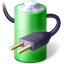
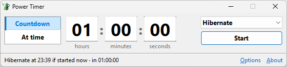

# Power Timer

**Shut down, restart, sign out, lock, sleep or hibernate Windows after a countdown or at a set time**

Power Timer is a small Windows tool that shuts down, restarts, signs out, locks, puts to sleep or hibernates the computer after a countdown or at a set time. It is a single `PowerTimer.exe` with no installer and no runtime dependencies, and it keeps its settings in the registry of the current user.

## Highlights

- **Countdown or At time.** Run the action after a number of hours, minutes and seconds, or when the clock shows a time, also if the clock changes meanwhile, e.g. to or from daylight saving time.
- **Six actions.** Shut down, Restart, Sign out, Lock, Sleep and Hibernate, with a check on *Start* that Sleep and Hibernate are available.
- **A warning a minute before.** It counts down the last seconds above all other windows, with *Cancel* and *+10 min*.
- **No surprise after sleep.** When the computer slept through the time of the action, the action is announced on waking and runs a minute later.
- **The time left at a glance** in the window title, on the taskbar button and in the tray.

## Screenshot

## Features

### Countdown and At time

- **Countdown** runs the action after the entered hours, minutes and seconds.
- **At time** runs the action when the clock shows the entered time, tomorrow if that time has already passed today, also if the clock is changed meanwhile, e.g. to or from daylight saving time.
- The status bar shows when the action will run: in *Countdown* mode if started now, in *At time* mode with *tomorrow* if the entered time has already passed today, and while it waits the end time and the time left.
- While it waits, *Countdown* mode counts down in the fields, and *At time* mode keeps showing the time the action runs at: the entered time, or later after adding time or after sleep.

### Actions

- **Shut down**, **Restart**, **Sign out**, **Lock**, **Sleep** and **Hibernate**.
- *Start* warns right away when Sleep or Hibernate isn't available on the computer, e.g. when hibernation is turned off, and asks whether to start anyway.
- *Force apps to close*, off by default: Shut down, Restart and Sign out then close apps without saving, instead of waiting at Windows' *closing apps* screen for one that doesn't close by itself, e.g. an editor with an unsaved document. Unsaved work is lost, so the warning a minute before the action is the time to save it. Lock, Sleep and Hibernate don't close apps.

### While the countdown runs

- The window title shows the time left first, e.g. *01:12:30 - Shut down - Power Timer*, so the taskbar button and Alt+Tab show it too, also when the window isn't minimized to the tray.
- The taskbar button fills up with a green bar as the time passes.
- *+10 min* in the status bar (Alt+M), in place of *Options* and *About*, adds time: the minutes set in the options, 10 by default.

### System tray

- Optional minimize to the system tray, with the remaining time in the tray tooltip.
- While a countdown runs, the tray icon's menu shows the time left in its first line, e.g. *Shut down in 00:42:17*; *Stop countdown* stops it and *Add 10 minutes* adds time.

### Warning before the action

- A minute before the action runs, a warning above all other windows counts down the last seconds, with *Cancel*, which stops the countdown, and *+10 min*, which runs the action 10 minutes later and warns again a minute before.
- There is no warning for a countdown of a minute or less, and it can be turned off in the options.
- When the computer was asleep or hibernating at the time the action was to run, the action doesn't run on waking without notice: the warning announces it, saying that the time passed while the computer was asleep, and it runs a minute after waking, also when the warning a minute before is turned off.

### Keyboard

- Up/Down arrow keys change the focused field.
- Enter starts the countdown and Esc stops it.
- Alt+O opens the options and Alt+A the About box; while the countdown runs, Alt+M adds time.

### Options

*Options* in the status bar (Alt+O), next to *About* (Alt+A), opens the Options dialog. *OK* applies the options and stores them in `HKEY_CURRENT_USER\Software\Power Timer`.

- **On startup**: the default action, and the default time delay, from 1 to 24 hours, 1 by default.
- **Behaviour**: minimize to the system tray, remember the window position, a warning for a zero countdown, the warning a minute before the action, the minutes to add time by (*Add time in steps of*, from 1 to 120, 10 by default; it sets the minutes of *+10 min* and *Add 10 minutes*, which show the number set) and *Force apps to close*.

## Download

Download `PowerTimer_v<version>_win-x64.zip` from the [releases](https://github.com/jurakovic/PowerTimer/releases) and extract `PowerTimer.exe`, a single native executable with no runtime dependencies.

- Releases marked as pre-release are previews of the next version.
- `checksums.txt` in each release has the SHA-256 checksum of the zip file.
- Every run of the [Build](https://github.com/jurakovic/PowerTimer/actions/workflows/build.yml) workflow has `PowerTimer.exe` of that commit under *Artifacts*, zipped like a release: `PowerTimer_v<version>_win-x64.zip`. Its version is the next release with the run number, e.g. `1.0.1-build.42`.

## Documentation

[INTERNALS.md](INTERNALS.md): building Power Timer from source, how it works, its settings in the registry, the tests, making changes and releasing.
