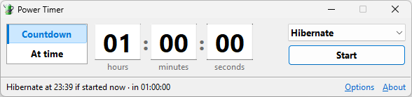

## PowerTimer

[](https://github.com/jurakovic/PowerTimer/releases)
[](https://github.com/jurakovic/PowerTimer/actions/workflows/build.yml)



A small Windows tool that shuts down, restarts, logs off, locks, suspends (sleep) or hibernates the computer after a countdown or at a set time.

- **Countdown** – run the action after the entered hours, minutes and seconds
- **At time** – run the action when the clock shows the entered time (tomorrow if that time has already passed today), also if the clock is changed meanwhile, e.g. to or from daylight saving time
- Up/Down arrow keys change the focused field; Enter starts the countdown and Esc stops it
- Optional minimize to the system tray, with the remaining time in the tray tooltip
- Options for the default action, the default time delay, remembering the window position and a warning for a zero countdown, shown with *Options* in the status bar, next to *About* (Alt+O, Alt+A); they are stored in `HKEY_CURRENT_USER\Software\Power Timer`

### Download

Download `PowerTimer_v<version>_win-x64.zip` from the [releases](https://github.com/jurakovic/PowerTimer/releases) and extract `PowerTimer.exe`, a single native executable with no runtime dependencies.

- Releases marked as pre-release are previews of the next version.
- `checksums.txt` in each release has the SHA-256 checksum of the zip file.
- Every run of the [Build](https://github.com/jurakovic/PowerTimer/actions/workflows/build.yml) workflow has `PowerTimer.exe` of that commit under *Artifacts*, zipped like a release: `PowerTimer_v<version>_win-x64.zip`. Its version is the next release with the run number, e.g. `1.0.1-build.42`.

### Build

Power Timer is written in Free Pascal with [Lazarus](https://www.lazarus-ide.org/) (Lazarus 4.8 / FPC 3.2.2).

- **IDE** – open `src/PowerTimer.lpi` in Lazarus and press *Run*
- **Command line**

	```
	lazbuild --build-mode=Release src/PowerTimer.lpi
	```

	The executable is written to `src/bin/x86_64-win64/PowerTimer.exe`. Its version, shown in the About box, is 0.0.0; release builds carry their version, see [Release](#release).

### Tests

The unit tests are an fpcunit console application:

```
lazbuild tests/PowerTimerTests.lpi
tests/bin/x86_64-win64/PowerTimerTests.exe
```

The [Build](.github/workflows/build.yml) workflow builds Power Timer, runs the tests and uploads `PowerTimer.exe`, zipped, for pushes to `master` that change the application or how it is built, and when run from the *Actions* tab (*Build* → *Run workflow*, for any branch).

### Release

Releases are made with the [Publish](.github/workflows/publish.yml) workflow (*Actions* → *Publish* → *Run workflow*), which runs the steps of `publish.sh`:

1. **Build** – runs the tests and builds `PowerTimer.exe` with the version
2. **Package** – zips `PowerTimer.exe` and writes `checksums.txt`
3. **Release** – tags the built commit `v<version>` and creates the GitHub release

The version is computed from the latest tag of the current major version: `master` gives the next release (e.g. `1.0.1`), other branches the next preview (`1.0.1-preview.1`). While a preview is open, a *Bump Type* that doesn't pass it continues it (*patch*, the default, always does), and one that passes it starts a new version: *minor* after `1.0.1-preview.2` gives `1.1.0`, or `1.1.0-preview.1` from another branch. *Base Ver* picks an older major version instead, e.g. `1` for a fix of 1.x after 2.0.0. `publish.sh` also runs locally in Git Bash, see `./publish.sh --help`.
